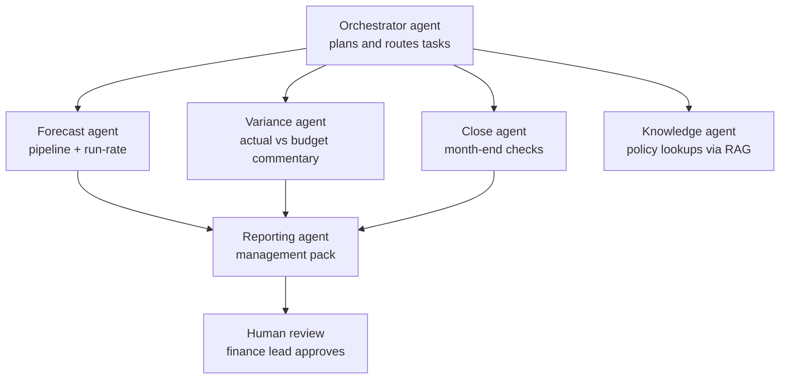

# Multi-agent finance team

A team of AI agents that each take one part of the finance job: forecasting, variance commentary, close checks and reporting, coordinated by an orchestrator.

## The problem

Month-end close usually takes a week or more. Most of that time goes into the same loop: collect data, reconcile, chase missing items, update the forecast, explain the variances, build the pack. Skilled people spend their days on assembly instead of analysis, and by the time management sees the numbers, the next month is already well underway. Single automations help, but a T+1 close only happens when the steps hand off to each other without someone in the middle.

## The approach



1. **Data in:** synthetic actuals, budget and CRM pipeline of a fictional B2B SaaS company, plus its finance policy documents.
2. **Processing:** an orchestrator agent breaks the request into tasks and routes them to specialist agents. It reuses the [CRM → RevOps → Finance pipeline](https://github.com/mtuantruong/crm-revops-finance-automation) for forecasting and the [finance knowledge assistant](https://github.com/mtuantruong/finance-knowledge-assistant) for policy questions.
3. **Output:** an updated forecast, written variance commentary, a list of close issues, and a draft management pack, ready for a human to review and approve.

## The result

Targets on the synthetic dataset:

- T+1 close: books closed, variances explained and management pack drafted on the first working day after month-end
- From assembly to analysis: agents run the checks and the first drafts, people focus on judgment and decisions
- Human in the loop: agents prepare, a finance lead reviews and signs off. Nothing is posted or sent without approval

## Tools

Python, LLM APIs, multi-agent orchestration, RAG, n8n, pandas

## Run it yourself

Coming soon ...

<!--
```bash
git clone https://github.com/mtuantruong/virtual-finance-team.git
cd virtual-finance-team
python -m venv .venv && source .venv/bin/activate
pip install -r requirements.txt
cp .env.example .env   # add your own API keys here, never commit .env
python src/main.py
```
-->

## Data

All data in `data/` is synthetic and describes a fictional company. It does not reflect any real company.

## License

MIT
